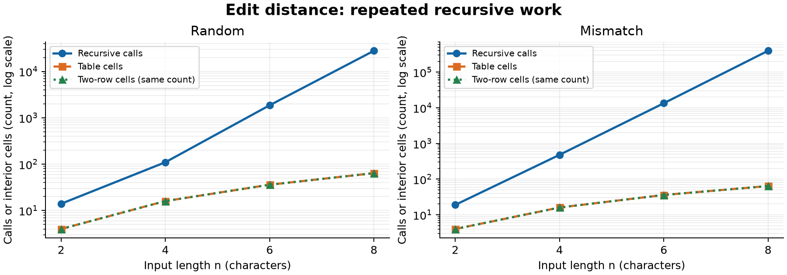
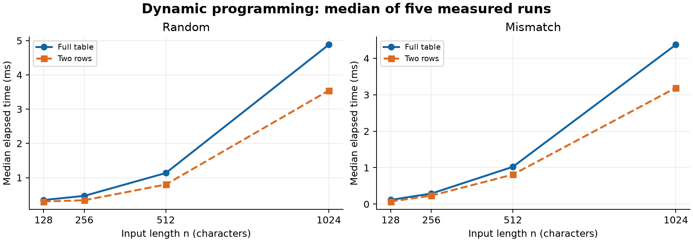
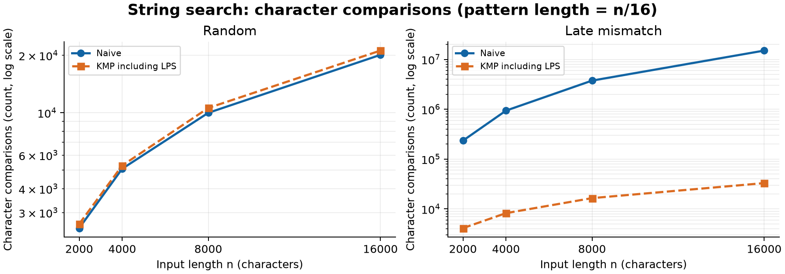

# Experiment Design Card

- **Question:** Edit Distance: how does repeated recursive work compare with DP as length grows, and does two-row DP preserve the table's work count? Search: how much repeated comparison does KMP avoid on late-mismatch patterns compared with random data?
- **Sizes:** All edit implementations use equal-length pairs at n = 2, 4, 6, 8 for direct comparison; table and two-row also use 128, 256, 512, 1024 to expose quadratic growth at measurable durations. Recursion stops at 8 to keep exponential branching practical. Both searches use text n = 2000, 4000, 8000, 16000 and pattern m = n/16, so the adversarial naive cost can grow quadratically. Every algorithm has at least four sizes spanning at least a factor of four.
- **Inputs:** Edit uses independent uniform random strings over ABCD to represent mixed matches and mismatches, and A repeated n times versus B repeated n times to force three recursive branches at every non-base state. Search uses uniform random ABCD text and pattern to show early mismatches, and A repeated n times against A repeated m-1 times followed by B to force the latest possible mismatch at every naive alignment. These deliberate difficult inputs expose work that random data can hide. Generator seed: 20261102; each family/type/size has its own deterministic seed derived from this value.
- **Metrics:** Record each of five measured runs in CSV, then report median milliseconds. Use three unrecorded warm-up calls per case. Count recursive calls (including base cases), interior DP cells, naive character comparisons, and KMP character comparisons split into LPS and search phases. Counters increment inside the algorithms and reset on each public operation. Calls and cells are distinct work units, not identical machine instructions. Record n, m, seed, input fingerprint and answer to audit repeatability; time includes allocation and KMP preprocessing but excludes input generation, validation and CSV writing.
- **Prediction:** All-mismatch recursion should grow exponentially and exceed random recursion; both DP variants should visit n*m cells regardless of content, with quadratic growth and equal answers. Two rows reduce storage from (n+1)*(m+1) integers to 2*(m+1), but timing superiority is not guaranteed. Naive late-mismatch comparisons should grow roughly quadratically with this growing pattern; KMP should grow linearly in n+m. Random naive search can compete with KMP because most comparisons fail early and KMP must preprocess its pattern.
- **Plots:** (1) Small edit work versus n, logarithmic work axis, to compare recursive growth and DP. (2) Large DP median time versus n, to inspect table/two-row runtime growth. (3) Search character comparisons versus text length, logarithmic work axis, to expose the effect of late mismatches. Every figure will include both input types and a takeaway. Predictions are committed before benchmark execution.

# Results: Edit Distance

Measurements were collected on Windows with Oracle JDK 25.0.1 (Java 17 compilation target) on 2 November 2026. There are 56 cases, each with five timed runs after three warm-ups: 200 edit rows and 80 search rows. The CSV preserves all 280 runs; the figures use medians. A separate runner verification produced identical input SHA-256 fingerprints, answers and counters for every row. Timings are not expected to reproduce exactly. The original design was retained without changes.

**Takeaway:** At n=8, all-mismatch recursion makes 398,593 calls while each DP version computes only 64 interior cells.

**Takeaway:** At n=1024, two-row DP is faster in these measurements while both DP versions perform exactly 1,048,576 cell updates.

**Prediction versus result (Edit Distance).** The operation counts support the predicted repeated-work growth: all-mismatch recursive calls rise from 19 at n=2 to 398,593 at n=8, compared with DP counts rising from 4 to 64. Random recursion reaches 27,823 calls at n=8, below the deliberately difficult case. Both DP variants have identical counts for both input types, and doubling n quadruples their interior-cell work. At n=1024, table/two-row medians are 4.8817/3.5431 ms on random input and 4.3751/3.1905 ms on mismatch input. These timings support a local advantage for two rows, not a guarantee for every JVM or input.

# Results: String Search and Timing

**Takeaway:** Growing n eightfold raises late-mismatch naive comparisons about 64-fold, while KMP comparisons including preprocessing grow about eightfold.

| Input, n | Naive comparisons | KMP comparisons, including LPS | Naive median (ms) | KMP median (ms) |
|---|---:|---:|---:|---:|
| Random, 2000 | 2,485 | 2,614 | 0.2447 | 0.2050 |
| Random, 16000 | 20,115 | 21,187 | 0.2923 | 0.3211 |
| Late mismatch, 2000 | 234,500 | 4,123 | 0.4937 | 0.0190 |
| Late mismatch, 16000 | 15,001,000 | 32,998 | 27.1342 | 0.1397 |

**Prediction versus result (Search).** The late-mismatch counts support the expected quadratic naive growth and linear KMP growth because m grows with n. At n=16000, KMP uses about 455 times fewer comparisons, including 1,997 LPS comparisons and 31,001 search comparisons. On random input, naive comparisons grow approximately linearly and are slightly fewer than KMP's, as predicted. All benchmark searches return no matches; tests separately establish correctness for successful and overlapping matches, so these experiments do not measure the cost of constructing large match lists.

**Unexpected results and time.** Some median times decrease as input grows: random naive search falls from 0.6006 ms at n=4000 to 0.1988 ms at n=8000, although its work increases. Tiny all-mismatch recursive cases also run faster than random ones despite more calls; input types execute in a fixed order, and three warm-ups do not ensure steady-state JVM compilation. JIT compilation, allocation, garbage collection, timer resolution and scheduling are plausible contributors, but this experiment did not isolate their individual effects. Thus neither these reversals nor the particularly low late-mismatch KMP times prove that difficult inputs are intrinsically faster. Larger DP times and naive late-mismatch times show clearer growth, and the five-run medians limit sensitivity to isolated delays; deterministic operation counts remain the stronger evidence about algorithmic scaling. The counters also add overhead, and recursive calls and DP cells are different work units rather than directly comparable CPU instructions.

# Short Answers

**1. Which input made string search slowest, and why?**

The slowest measured search case was Naive on the late-mismatch input at n=16000, m=1000, with a 27.1342 ms median. Every valid alignment matches 999 A characters before failing on the final B, so almost all previous work is repeated at the next start. The measured 15,001,000 comparisons expose this cost directly. KMP reuses prefix information and needs 32,998 comparisons including preprocessing on the same case; its own largest observed median was 0.3486 ms on random n=4000, illustrating the timing limitations described above.

**2. How large an n could recursive Edit Distance handle, and what stopped it?**

The largest benchmarked equal string length was n=8, which completed at a 0.6320 ms median for all-mismatch input. This is the experiment's deliberate cap, not a measured machine limit; the reference tests also successfully evaluate the length-9 intention/execution pair. At n=8 the mismatch case already makes 398,593 calls, compared with only 64 DP cells, because identical prefix subproblems recur on many branches. The study stopped expansion to keep the planned experiment practical, rather than claiming a timeout or stack failure that was never observed.

**3. What do two rows gain and lose compared with the full table?**

Two rows preserve the distance and O(nm) running time while reducing stored integer cells from (n+1)(m+1) to 2(m+1). For n=m=1024, that means 1,050,625 versus 2,050 integers, excluding Java array overhead; these are structural storage calculations, not measured memory counters. The measured work remains 1,048,576 interior cells for both versions, and two rows are faster at this largest tested size. Discarding older rows prevents straightforward traceback of an edit sequence, so reconstruction would require extra storage or recomputation.

**4. Which search would you choose for the city platform, and why?**

I would choose KMP for potentially long log searches because its O(n+m) comparison bound protects against repetitive text and late mismatches. At the largest adversarial case, it reduces comparisons from 15,001,000 to 32,998 and returns the same result. Its LPS preprocessing costs O(m) space and work, so Naive remains competitive on random inputs and small patterns. KMP also supports overlapping matches, which are required here, without moving backward in the text.

## Validation

All eight JUnit 5 test methods pass, covering every Section 7 reference, empty strings and patterns, longer patterns, absent and overlapping matches, 100 seeded short edit pairs and 100 seeded search texts. Counter tests check small hand-counted cases, reset behavior and LPS inclusion. The benchmark independently checks answers against a family reference and verifies counters across its five runs. All 280 rows also match the separate verification run in every field except elapsed time; each figure was generated from the committed CSV and visually inspected.
